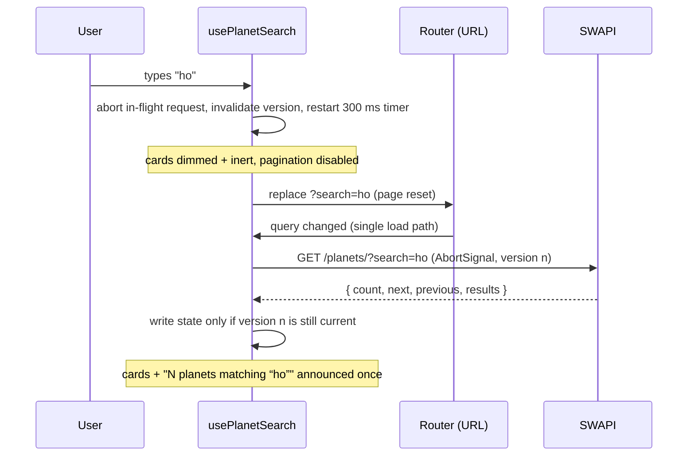

# Star Wars Atlas

A Vue 3 + TypeScript app for the Nmbrs frontend technical test. It browses every planet in
[SWAPI](https://swapi.dev): a searchable, paginated list showing the films each planet appears
in, and a detail page with all of a planet's data. Each planet is illustrated with artwork
generated from its own climate and terrain.

> **Live demo:** _add the Vercel URL here after deploying_

| Requirement (from the brief)                          | Where                                                                                                                |
| ----------------------------------------------------- | -------------------------------------------------------------------------------------------------------------------- |
| Planets view: name + names of the films it appears in | [`PlanetsView`](src/views/PlanetsView.vue), [`PlanetCard`](src/components/planets/PlanetCard.vue)                    |
| Single planet view with all its information           | [`PlanetDetailView`](src/views/PlanetDetailView.vue)                                                                 |
| Server-side, debounced, cancellable search            | [`usePlanetSearch`](src/composables/usePlanetSearch.ts), [ADR 0004](docs/decisions/0004-search-request-lifecycle.md) |
| TypeScript, Vue, Sass                                 | Throughout, [ADR 0001](docs/decisions/0001-stack.md)                                                                 |
| Design patterns                                       | [ADR 0002](docs/decisions/0002-architecture.md)                                                                      |
| UX, responsive design, accessibility                  | [ADR 0009](docs/decisions/0009-accessibility-ux.md)                                                                  |
| Unit and integration tests                            | `src/**/__tests__`, [ADR 0010](docs/decisions/0010-testing.md)                                                       |

## Getting started

Requires **Node.js 22.18+ or 24.12+** and npm.

```bash
npm ci
npm run dev        # http://localhost:5173
```

### Scripts

| Script                    | What it does                                               |
| ------------------------- | ---------------------------------------------------------- |
| `npm run dev`             | Vite dev server with hot reload                            |
| `npm run build`           | Type-check (`vue-tsc`) and production build to `dist/`     |
| `npm run preview`         | Serve the production build locally                         |
| `npm test`                | Run all unit and integration tests once                    |
| `npm run test:watch`      | Tests in watch mode                                        |
| `npm run test:coverage`   | Tests with a v8 coverage report (`coverage/`)              |
| `npm run lint`            | Oxlint + ESLint (with `--fix`)                             |
| `npm run format`          | Prettier on `src/`                                         |
| `npm run check`           | Type-check, lint and test: the gate run before each commit |
| `npm run storybook`       | Component explorer at http://localhost:6006                |
| `npm run build-storybook` | Static Storybook build to `storybook-static/`              |

### Configuration

Optional: copy `.env.example` to `.env.local` to point the app at a SWAPI mirror or proxy.

```bash
VITE_SWAPI_BASE_URL=https://swapi.dev/api   # default
```

## Running the tests

```bash
npm test
```

There are 113 tests across 15 files, and they take about 4 seconds. Nothing calls the live API:
`fetch` is replaced with a hand-controlled fake ([`src/test/fetch.ts`](src/test/fetch.ts)), so
tests can resolve, reject or abort each request in any order. Fake timers cover the 300 ms
debounce and the request timeout. Statement coverage is about 91%.

- **Unit**: mappers, URL building, error normalisation and timeout, formatting, the summary
  sentence, biome rules, planet artwork.
- **Composable integration**: `usePlanetSearch` and `useFilms`, mounted with a real router.
  This covers all eight required search behaviours: debounce, encoding, results and totals,
  pagination reset, clear, stale-response races, states and retry, unmount cleanup.
- **View integration**: `PlanetsView` and `PlanetDetailView` rendered with the DOM, covering
  cards, counts, the "updating" state, empty and error states, retry, focus and the back link.

The [testing ADR](docs/decisions/0010-testing.md) maps each required behaviour to its test.

## Architecture

```
src/
  api/            service layer: http.ts (fetch + timeout + ApiError), swapi.ts, mappers.ts, DTO types
  models/         domain types used by the UI (Planet, Film, Person, Page<T>)
  composables/    usePlanetSearch (search + URL + race safety), usePlanet, useFilms
  components/
    planets/      list pieces: SearchField, PlanetCard, PaginationNav
    planet/       PlanetArt (+ appearance rules), FactList
    ui/           StatusPanel, AppButton
    layout/       AppHeader, AppFooter
  views/          containers: PlanetsView, PlanetDetailView, NotFoundView
  utils/          latestRequest guard, query parsing, formatting, describePlanet
  styles/         tokens (CSS custom properties) + Sass mixins/breakpoints
docs/
  decisions/      architecture decision records (ADRs)
  assignment/     the assignment brief (Task.pdf)
  design/         design direction references
```

Data flows one way: **service → mappers → composables → views → presentational components**.
Components never fetch, and composables never touch the DOM.

### How search works



The same load path serves paging (`?page=` with the query kept), back/forward, pasted links and
the first render. Clear cancels everything and commits the unfiltered page 1 at once.

## Design

The direction comes from the two references in [`docs/design/`](docs/design/), followed as
inspiration, not pixel by pixel:

- **List page:** dark glass cards and an uppercase display face, from the dashboard reference.
- **Detail page:** a large glowing name, a row of key facts with square bullets, orbit rings and
  scan lines, from the planet reference.

There is one restrained accent colour (yellow) plus green for "online" status.

SWAPI has no images, so **each planet is drawn in SVG from its data**:

- **Biome:** weighted keyword rules turn climate and terrain into one of 11 biomes, such as
  desert, ice world, gas giant, ecumenopolis or volcanic.
- **Uniqueness:** a hash of the name seeds the noise, so each planet looks different but the same
  on every visit.
- **Layers:** clouds, polar caps, lava veins and night-side city lights are added where they fit.

See [ADR 0007](docs/decisions/0007-procedural-planet-art.md), or the _Biome gallery_ story in
Storybook.

## Header and hero

- **Header:** a sci-fi console. It shows a live clock, the real network state ("Link stable"
  or "Link lost") and a light travelling along its bottom edge.
- **Hero:**
  - the headline lines rise in turn, and a light sweeps across "CHART.";
  - Tatooine is drawn by the same generated art as the cards, inside rotating dials and
    orbiting satellites;
  - a status label decodes into place once.
- **Archive stats:** planets charted, films indexed and residents logged. Their digits shuffle
  until SWAPI answers, then lock onto the real values, and a meter charges up under each one.
  The shuffle doubles as the loading state, so no invented number is ever shown as real. See
  [ADR 0013](docs/decisions/0013-sci-fi-header-and-hero.md).

## Motion and card identity

- **Card to detail and back:** the planet's art and name fly between its card and the detail
  hero, using the View Transitions API.
- **Paging and search:** old cards fade out and new ones rise in with a stagger. Cards in both
  result sets slide to their new place, and the search field stays live throughout.
- **Planet colour:** each card takes its planet's colour for its border light, glow, number,
  hover arrow and gauges.
- **Ambient glint:** a glint of the planet's colour slowly circles each card's border, each
  card at its own pace.
- **Hover:** a glare follows the pointer, the planet leans towards it, and a scan line sweeps
  across the art.
- **Gauges:** small bars compare size, surface water and population at a glance.

All of it is progressive enhancement and turns off under `prefers-reduced-motion`. See
[ADR 0012](docs/decisions/0012-motion-and-identity.md).

## Error handling

Every failure becomes a typed `ApiError` (`network`, `timeout`, `http`, `not-found`, `parse`),
and the UI shows each one as a clear, recoverable state:

- **Retry:** re-runs the current query and page.
- **Not found:** an unknown planet id gets a "not in the archive" page.
- **Page too far:** an out-of-range page offers "Go to page 1".
- **Partial failures:** unavailable film titles or residents are labelled, not hidden.

Requests time out after 15 s, because swapi.dev sometimes hangs instead of failing.
Cancellation (`AbortError`) is never shown as an error. See
[ADR 0006](docs/decisions/0006-error-handling.md).

## Deploying to Vercel

The repo deploys as-is. [`vercel.json`](vercel.json) sets the Vite build, an SPA rewrite (so deep
links like `/planets/1` work on refresh) and long-lived caching for hashed assets.

1. Import the repository in Vercel. It detects Vite: build `npm run build`, output `dist`.
2. Optionally set `VITE_SWAPI_BASE_URL` in the project's environment variables.

## Decisions and trade-offs

Every non-obvious choice has a short ADR in [`docs/decisions/`](docs/decisions/README.md). The
main trade-offs:

- **No Pinia / TanStack Query / Axios / VueUse.** The URL holds list state, a memoised promise
  shares the film catalogue, and a ~30-line guard handles request races. Each tool is named as
  the next step if the app grew.
- **The URL is the source of truth.** Searches and pages are shareable and survive reloads.
  The list stays alive while a planet is open, so Back is instant and keeps your scroll
  position.
- **View Transitions instead of an animation library.** Browsers without them, and anyone who
  prefers reduced motion, get instant updates.
- **Residents are fetched one by one** on the detail page (SWAPI has no batch endpoint); film
  names come from one shared catalogue request.
- **Manual retry instead of automatic retries with backoff**, so the behaviour is predictable
  and doesn't add load to an API that is already struggling.
- **Storybook covers presentational components only**, with the a11y addon. Container views are
  covered by integration tests instead.
- **No E2E tests** for now, by agreement. The view-level integration tests cover the main flows.

## Known limitations

- SWAPI's `search` matches planet names only (case-insensitive substring). That is the API's
  behaviour, not a client-side filter.
- swapi.dev availability is outside the app's control. The UI degrades and offers a retry.
- The artwork is an artist's impression from the data, not canon imagery. SVG noise filters
  cost some CPU, so cards only animate on hover and all motion respects reduced-motion settings.
- If the film catalogue fails to load on the list, there is no inline retry. A reload or the
  detail page's retry fetches it again.
- English only; no i18n.
